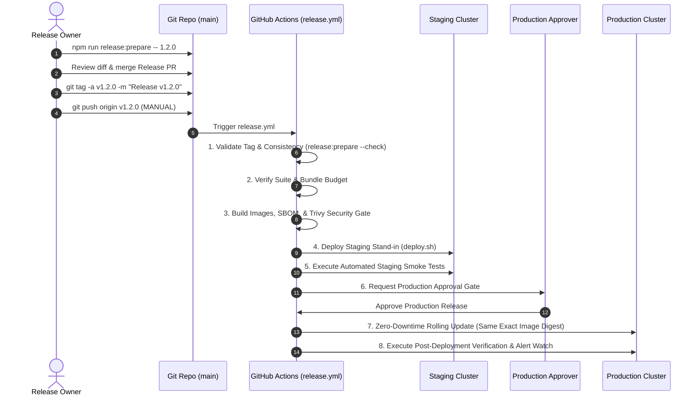

# Flash Chat — Production Release & Operations Runbook (RELEASING.md)

This runbook establishes the official versioning policy, release preparation tooling, end-to-end release procedures, emergency hotfix workflows, halfway-failure recovery matrix, and rollback protocols for the Flash Chat platform.

See also [docs/RELEASING.md](file:///c:/Users/kg872/Documents/GitHub/Flash-chat/docs/RELEASING.md).

---

## 1. Semantic Versioning Policy

Flash Chat strictly follows [Semantic Versioning (SemVer 2.0.0)](https://semver.org/):

| Change Category | SemVer Component | Version Example | Criteria & Examples |
| :--- | :--- | :--- | :--- |
| **Breaking Change** | **MAJOR (X.0.0)** | `2.0.0` | Incompatible API contract changes, dropping legacy client support, database migrations requiring mandatory schema drops (non-expand/contract), or breaking cryptographic changes. |
| **New Features** | **MINOR (1.X.0)** | `1.2.0` | Backwards-compatible feature additions (e.g., Contacts Engine, Support Desk, Flash AI tools), additive API endpoints, non-breaking database schema expansions. |
| **Patches & Fixes** | **PATCH (1.1.X)** | `1.1.1` | Backwards-compatible bug fixes, security patches, styling/token fixes, documentation updates, and performance optimizations. |
| **Pre-Releases** | **PRE-RELEASE** | `1.2.0-rc.1` | Release Candidates for staging verification and QA sign-off. Deployed to staging only; never deployed to production. |

### Immutability Rule
> [!IMPORTANT]
> **A published Git tag and container image digest is NEVER moved, overwritten, or reused.** Once a version `vX.Y.Z` has been tagged and built, any subsequent bug fix must be issued as a new patch (`vX.Y.Z+1`).

---

## 2. Pre-Release Quality Checklist

Before preparing or cutting a production release, the release coordinator and on-call engineer must verify:

1. **Main Branch CI Status is 100% Green**:
   - `backend-test`: Node 20, Redis, MongoDB, `docs:check`, `projectAudit`, and all 11 backend test suites pass.
   - `frontend-test`: Client unit & security suites, `lint:tokens`, `lint:brand`, `test:a11y`, and `perf:bundle` (< 250 KB gzip) pass.
   - `e2e-and-audit`: Visual regression (`test:visual`), cross-browser suites (`test:crossbrowser`), and Lighthouse CI (`perf:lhci`) pass.
   - `docker-build`: Multi-stage Dockerfile builds for `server/Dockerfile.prod` and `client/Dockerfile.prod` pass.
   - Security: CodeQL analysis and Gitleaks secret scans pass with 0 warnings.
2. **Zero Blocker Issues**: No open P0/P1 bugs in the issue tracker.
3. **Database Migration Safety**:
   - All migrations adhere to the **Expand/Contract** paradigm.
   - Migrations are idempotent (0 records changed on re-run).
   - Index creations run in background with zero table/collection locking.
4. **Disaster Recovery & Backup Freshness**:
   - MongoDB automated backup verified within `< 6 hours` (`./scripts/verify-backup.sh`).
5. **Staging Environment Healthy**:
   - Staging smoke suite passes (`./scripts/smoke-prod.sh --staging`).
6. **On-Call Availability**:
   - Release owner and at least one secondary reviewer are available for the entire 2-hour active deployment window.

---

## 3. Step-by-Step Release Procedure



### Step 1: Run Release Preparation Tooling
On a clean `main` branch:
```bash
# 1. Preview changes with dry-run
npm run release:prepare -- 1.2.0 --dry-run

# 2. Execute release preparation
npm run release:prepare -- 1.2.0
```

### Step 2: Open Release PR & Tag
```bash
# Review diff
git diff

# Commit release metadata
git add package.json server/package.json client/package.json package-lock.json CHANGELOG.md
git commit -m "chore(release): v1.2.0"

# Create annotated tag
git tag -a v1.2.0 -m "Release v1.2.0"

# Push tag to trigger workflow (MANUAL STEP)
git push origin main
git push origin v1.2.0
```

### Step 3: Post-Deployment Verification & Record
```bash
# Verify health version
curl -s https://chat.flash.internal/api/health | jq .version

# Run smoke tests
./scripts/smoke-prod.sh

# Generate release record
npm run release:record -- --version 1.2.0
```

---

## 4. Rollback Triggers & Thresholds
- **5xx Error Rate**: `> 1.0%` for 5 minutes ➔ Run `./scripts/rollback.sh`
- **Login Failure Rate**: `> 2x` baseline ➔ Run `./scripts/rollback.sh`
- **Socket Reconnect Storm**: `> 50 reconnects/s` ➔ Run `./scripts/rollback.sh`
- **p95 Latency**: `> 200ms` for 5 minutes ➔ Investigate / Rollback
- **Database Rollback**: `./scripts/rollback.sh --reverse-migration` (only if migration is reversible and no active writes depend on it).

---

## 5. Emergency Procedures
- **Maintenance Mode**: `./scripts/maintenance.sh on` / `./scripts/maintenance.sh off`
- **Leaked Secrets**: Run `./scripts/gen-secrets.sh`, update `.env.production`, and recreate containers.

