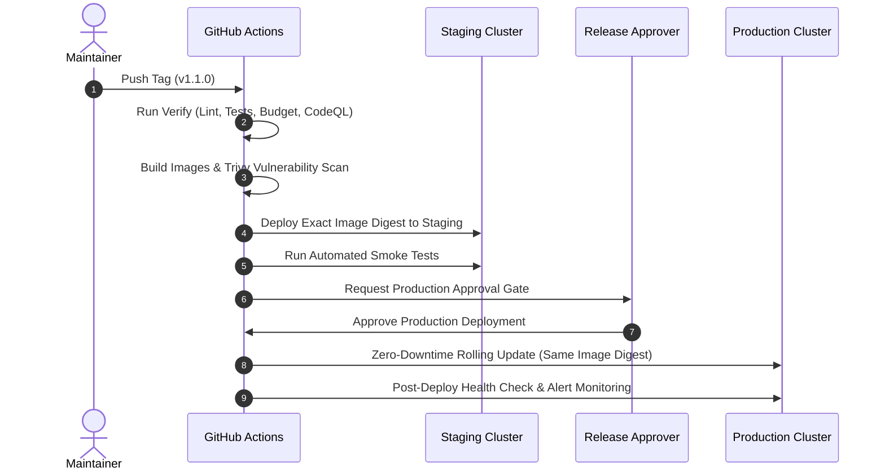

# Flash Chat — Release & Deployment Runbook (RELEASING.md)

This runbook specifies the official versioning policy, step-by-step release procedure, emergency hotfix workflows, and rollback protocols for Flash Chat.

---

## 1. Semantic Versioning Policy

Flash Chat follows [Semantic Versioning (SemVer 2.0.0)](https://semver.org/):
- **MAJOR (X.0.0)**: Incompatible architectural breaks or breaking API changes.
- **MINOR (1.X.0)**: Backwards-compatible new features (e.g. Contacts Engine, Support Desk, Flash AI rebrand).
- **PATCH (1.1.X)**: Backwards-compatible bug fixes and security patches.
- **Pre-releases (1.1.0-rc.1)**: Release candidate builds deployed to staging for QA sign-off.

---

## 2. Standard Production Release Workflow



### Step-by-Step Release Steps:
1. **Verify Main Branch Status**: Ensure all automated PR quality gates on `main` are green.
2. **Update CHANGELOG & Version**: Ensure [CHANGELOG.md](file:///c:/Users/kg872/Documents/GitHub/Flash-chat/CHANGELOG.md) has an entry for the version and subproject `package.json` versions match.
3. **Tag & Push**:
   ```bash
   git tag -a v1.1.0 -m "Flash Chat Release v1.1.0"
   git push origin v1.1.0
   ```
4. **Monitor Staging Verification**: Watch GitHub Actions `.github/workflows/release.yml` deploy to staging and verify health.
5. **Approve Production Gate**: Review test outputs and approve production deployment in the GitHub Actions environment.
6. **Post-Deployment Verification**:
   - Verify `/api/health` returns `version: "1.1.0"`.
   - Verify client **Settings > About** displays `v1.1.0`.

---

## 3. Emergency Hotfix Procedure

When a critical production bug requires an immediate patch without pulling unverified `main` features:

1. **Branch from the Tag**:
   ```bash
   git checkout -b hotfix/v1.1.1 v1.1.0
   ```
2. **Apply Minimal Fix & Verify**:
   ```bash
   npm run docs:check
   npm --prefix server test
   npm --prefix client test
   ```
3. **Bump Patch Version & Update Changelog**:
   Update `package.json` files to `1.1.1` and add a `[1.1.1]` section to `CHANGELOG.md`.
4. **Tag & Deploy**:
   ```bash
   git commit -am "fix(core): resolve connection timeout in call signaling"
   git tag -a v1.1.1 -m "Flash Chat Hotfix v1.1.1"
   git push origin v1.1.1
   ```
5. **Merge Back to Main**:
   ```bash
   git checkout main
   git merge hotfix/v1.1.1
   git push origin main
   ```

---

## 4. Rollback Protocols

If unexpected errors occur post-release:
- **Instant Image Rollback**: Run `./scripts/rollback.sh` on the server host to shift traffic to the previous verified release tag.
- **Reverse Database Migration**: If database schema changes need to be rolled back:
  ```bash
  ./scripts/rollback.sh --reverse-migration
  ```
