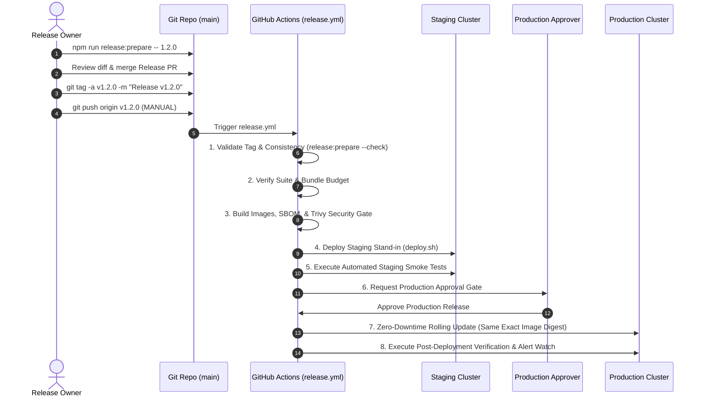

# Flash Chat — Production Release & Operations Runbook (RELEASING.md)

This runbook establishes the official versioning policy, release preparation tooling, end-to-end release procedures, emergency hotfix workflows, halfway-failure recovery matrix, and rollback protocols for the Flash Chat platform.

---

## 1. Semantic Versioning Policy

Flash Chat strictly follows [Semantic Versioning (SemVer 2.0.0)](https://semver.org/):

| Change Category | SemVer Component | Version Example | Criteria & Examples |
| :--- | :--- | :--- | :--- |
| **Breaking Change** | **MAJOR (X.0.0)** | `2.0.0` | Incompatible API contract changes, dropping legacy client support, database migrations requiring mandatory schema drops (non-expand/contract), or breaking cryptographic changes. |
| **New Features** | **MINOR (1.X.0)** | `1.2.0` | Backwards-compatible feature additions (e.g., Contacts Engine, Support Desk, Flash AI tools), additive API endpoints, non-breaking database schema expansions. |
| **Patches & Fixes** | **PATCH (1.1.X)** | `1.1.1` | Backwards-compatible bug fixes, security patches, styling/token fixes, documentation updates, and performance optimizations. |
| **Pre-Releases** | **PRE-RELEASE** | `1.2.0-rc.1` | Release Candidates for staging verification and QA sign-off. Deployed to staging only; never deployed to production. |

### Immutability Rule
> [!IMPORTANT]
> **A published Git tag and container image digest is NEVER moved, overwritten, or reused.** Once a version `vX.Y.Z` has been tagged and built, any subsequent bug fix must be issued as a new patch (`vX.Y.Z+1`).

---

## 2. Pre-Release Quality Checklist

Before preparing or cutting a production release, the release coordinator and on-call engineer must verify:

1. **Main Branch CI Status is 100% Green**:
   - `backend-test`: Node 20, Redis, MongoDB, `docs:check`, `projectAudit`, and all 11 backend test suites pass.
   - `frontend-test`: Client unit & security suites, `lint:tokens`, `lint:brand`, `test:a11y`, and `perf:bundle` (< 250 KB gzip) pass.
   - `e2e-and-audit`: Visual regression (`test:visual`), cross-browser suites (`test:crossbrowser`), and Lighthouse CI (`perf:lhci`) pass.
   - `docker-build`: Multi-stage Dockerfile builds for `server/Dockerfile.prod` and `client/Dockerfile.prod` pass.
   - Security: CodeQL analysis and Gitleaks secret scans pass with 0 warnings.
2. **Zero Blocker Issues**: No open P0/P1 bugs in the issue tracker.
3. **Database Migration Safety**:
   - All migrations adhere to the **Expand/Contract** paradigm.
   - Migrations are idempotent (0 records changed on re-run).
   - Index creations run in background with zero table/collection locking.
4. **Disaster Recovery & Backup Freshness**:
   - MongoDB automated backup verified within `< 6 hours` (`./scripts/verify-backup.sh`).
5. **Staging Environment Healthy**:
   - Staging smoke suite passes (`./scripts/smoke-prod.sh --staging`).
6. **On-Call Availability**:
   - Release owner and at least one secondary reviewer are available for the entire 2-hour active deployment window.

---

## 3. Step-by-Step Release Procedure



### Step 1: Run Release Preparation Tooling
On a clean `main` branch:
```bash
# 1. Preview changes with dry-run
npm run release:prepare -- 1.2.0 --dry-run

# 2. Execute release preparation
npm run release:prepare -- 1.2.0
```
This automatically:
- Validates clean git tree and branch status.
- Validates SemVer validity and ensures `target > current`.
- Verifies `CHANGELOG.md` `[Unreleased]` has content and zero `TODO`/`FIXME` markers.
- Updates `package.json`, `server/package.json`, and `client/package.json`.
- Transforms `[Unreleased]` into `## [1.2.0] - YYYY-MM-DD` and adds a fresh `[Unreleased]` block.
- Updates bottom compare links.
- Runs `docs:check`, `lint:tokens`, and `lint:brand`.

### Step 2: Open Release PR & Tag
```bash
# Review diff
git diff

# Commit release metadata
git add package.json server/package.json client/package.json package-lock.json CHANGELOG.md
git commit -m "chore(release): v1.2.0"

# Create annotated tag
git tag -a v1.2.0 -m "Release v1.2.0"

# Push tag to trigger workflow (MANUAL STEP)
git push origin main
git push origin v1.2.0
```

### Step 3: Monitor GitHub Actions Workflow
Watch `.github/workflows/release.yml` execution across its sequential stages:
1. `prepare`: Validates tag consistency and runs `node scripts/release-prepare.js --check v1.2.0`.
2. `verify`: Executes backend/client test suites, token strictness, and bundle budget gates.
3. `build-and-push`: Builds production container images, generates SBOMs, and gates on Trivy vulnerability scans (0 High/Critical).
4. `deploy-staging`: Deploys container digests to staging environment and runs smoke tests.
5. `release`: Creates GitHub release with extracted changelog notes and SBOM artifacts.
6. `deploy-production`: Requires authorized manual review in GitHub Environment, verifies digest equality (`staging digest === production digest`), and executes zero-downtime rolling update.

### Step 4: Staging 10-Minute Exploratory Verification
Before approving production, perform a quick manual verification on staging:
- [ ] User authentication (Login, Register, Session token refresh).
- [ ] Direct realtime messaging & Socket.io reconnection.
- [ ] WebRTC voice/video call signaling.
- [ ] Pocket Vault encrypted file upload and decryption.
- [ ] Flash AI Assistant chat triage.
- [ ] Contacts import via CSV/VCF.

### Step 5: Post-Deployment Verification (Production)
Once production deployment completes:
1. **Version Alignment**:
   - `curl -s https://chat.flash.internal/api/health | jq .version` (must return `"1.2.0"`)
   - Client **Settings > About** displays `v1.2.0`.
2. **Automated Smoke Test**:
   ```bash
   ./scripts/smoke-prod.sh
   ```
3. **Generate Production Release Record**:
   ```bash
   npm run release:record -- --version 1.2.0
   ```

---

## 4. Post-Release Monitoring Window & Rollback Triggers

Maintain intense active monitoring for the first **2 hours** post-release, followed by standard observation for **24 hours**.

### Quantitative Rollback Thresholds:
| Telemetry Metric | Alert / Rollback Trigger Condition | Action |
| :--- | :--- | :--- |
| **HTTP 5xx Error Rate** | `> 1.0%` of all requests over a sustained 5-minute window | Immediate Rollback |
| **Authentication Failures** | `> 2.0x` baseline failure rate for > 3 minutes | Immediate Rollback |
| **Socket Reconnect Storm** | `> 50 reconnects/sec` per server node or client disconnect loop | Immediate Rollback |
| **p95 Latency** | `> 200ms` (or `> 2.0x` baseline) for > 5 minutes | Investigate / Rollback |
| **Memory / CPU Saturation** | Container memory `> 90%` limit with OOM kills | Scale / Rollback |
| **Critical Bug Reports** | `5+` severity-high user support tickets filed within 15 minutes | Immediate Rollback |

### Rollback Commands:
```bash
# 1. Standard Container Image Rollback (Zero Downtime)
./scripts/rollback.sh

# 2. Rollback with Database Migration Reversal (CAUTION)
# Only run if database migrations are reversible and no active writes depend on them
./scripts/rollback.sh --reverse-migration
```

---

## 5. "Release Failed Halfway" Decision Matrix

If a release pipeline fails midway, use this decision table:

| Failing Pipeline Stage | Published Artifacts | Safe to Re-run? | Cleanup Required | Action & Resolution |
| :--- | :--- | :--- | :--- | :--- |
| **1. `prepare`** | None | Yes | None | Fix version mismatch or CHANGELOG formatting; push new commit or correct tag. |
| **2. `verify`** | None | Yes | None | Fix broken test or lint failure on branch; delete local tag before retagging. |
| **3. `build-and-push`** | Partial local container layers | Yes | None | Re-running job rebuilds and pushes cleanly. Digests are immutable. |
| **4. Scan (Trivy)** | Images pushed to registry | Yes | Add CVE to `.trivyignore` if verified false positive | If real CVE, abandon version, patch base image or package, and cut `vX.Y.Z+1`. |
| **5. `release` (GitHub)** | Draft release notes | Yes | Delete draft release in GitHub UI if corrupted | Re-running updates existing release draft idempotently. |
| **6. `deploy-staging`** | Deployed to staging | Yes | `./scripts/reset-staging.sh` | Debug staging deployment logs; staging failure prevents production job from running. |
| **7. `deploy-production`** | Staging verified; Prod partially updated | Yes (or Rollback) | Run `./scripts/rollback.sh` if prod containers degraded | Re-running executes rolling replacement to target digest. If fatal code bug, run rollback and cut patch version. |

---

## 6. Emergency Hotfix Procedure

When a critical production bug requires an immediate patch without pulling unverified features on `main`:

```bash
# 1. Create hotfix branch from production release tag
git checkout -b hotfix/v1.1.1 v1.1.0

# 2. Implement minimal fix and add regression test
# (Keep changes localized to the critical defect)

# 3. Validate locally
npm run docs:check
npm --prefix server test
npm --prefix client test

# 4. Bump patch version using release tooling
npm run release:prepare -- 1.1.1 --allow-dirty

# 5. Commit, tag, and push
git commit -am "fix(auth): prevent session drop on token rotation race"
git tag -a v1.1.1 -m "Hotfix v1.1.1"
git push origin hotfix/v1.1.1
git push origin v1.1.1

# 6. Merge hotfix back into main to prevent regression
git checkout main
git merge hotfix/v1.1.1
git push origin main
```

---

## 7. Emergency Procedures & Circuit Breakers

### Instant Maintenance Mode:
```bash
# Enable 503 Maintenance Mode
./scripts/maintenance.sh on

# Disable Maintenance Mode
./scripts/maintenance.sh off
```

### Risk Mitigation Feature Flags & Kill Switches:
| Risk Area | Environment Variable / Flag | Behavior When Disabled |
| :--- | :--- | :--- |
| **Flash AI Assistant** | `AI_ENABLED=false` | Disables AI triage and AI chat endpoints; returns graceful fallback message. |
| **Web Push Dispatch** | `PUSH_ENABLED=false` | Bypasses VAPID push notifications; falls back to in-app WebSocket events. |
| **User Invitations** | `INVITES_ENABLED=false` | Halts outbound SMS/Email contact invite dispatch. |
| **New Registrations** | `REGISTRATION_DISABLED=true` | Blocks `/api/auth/register` to prevent spam wave during incident. |

### Leaked Secret Rotation:
If credentials or JWT secrets are compromised:
1. Run `./scripts/gen-secrets.sh` to generate cryptographically random secrets.
2. Update `.env.production` on VPS host.
3. Invalidate active user tokens by incrementing `tokenVersion` or clearing Redis token cache.
4. Restart production services: `docker compose -f docker-compose.prod.yml up -d --force-recreate`.
